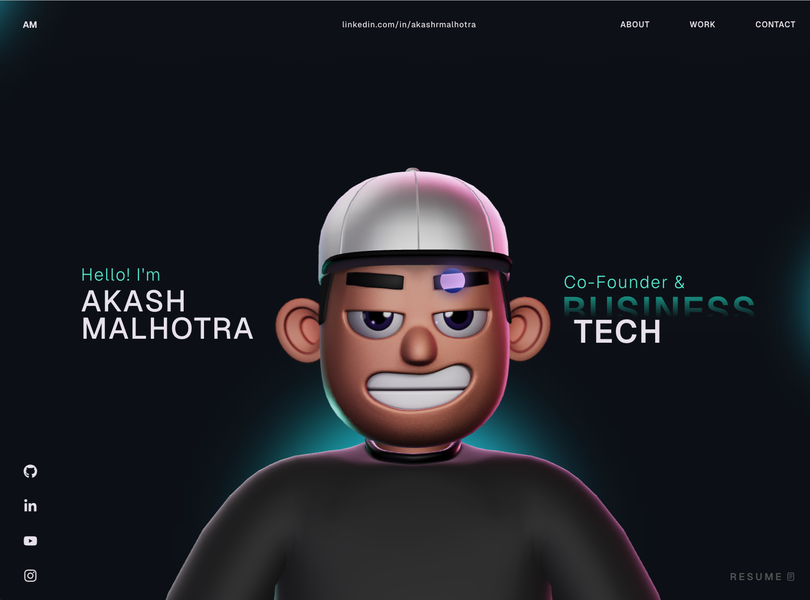

# Abhay Munjewar — Portfolio

A 3D, interactive portfolio for **Abhay Munjewar**, an AI/ML engineer and Computer Engineering student at VJTI, Mumbai. The site brings together selected projects, areas of work, experience, and contact links in an animated single-page experience.



## Highlights

- Interactive 3D character scene built with Three.js and React Three Fiber.
- Scroll based animation and page transitions using GSAP.
- Sections for About, services, experience, projects, and contact.
- Project carousel featuring AI, NLP, speech analysis, and GovTech work.
- Responsive layout, custom cursor, and loading experience.

## Tech stack

- React 18, TypeScript, and Vite
- Three.js, React Three Fiber, Drei, and React Three Rapier
- GSAP and `@gsap/react`
- CSS, React Icons, and `react-fast-marquee`

## Run locally

### Requirements

- Node.js 18 or newer
- npm

### Setup

```bash
git clone https://github.com/AbhayMunjewar/Abhay_portfolio_new.git
cd Abhay_portfolio_new
npm install
npm run dev
```

Vite prints the local development URL in the terminal, usually `http://localhost:5173`.

## Scripts

| Command | Description |
| --- | --- |
| `npm run dev` | Start the Vite development server |
| `npm run build` | Type-check and create a production build in `dist/` |
| `npm run preview` | Preview the production build locally |
| `npm run lint` | Run ESLint |

## Project layout

```text
public/                  Static images, 3D model files, Draco decoder, and résumé PDF
src/
  assets/                Imported source assets
  components/            Portfolio sections and UI components
    Character/           3D character scene and helpers
    styles/              Component stylesheets
    utils/               Animation and scroll utilities
  context/               Shared loading state
  data/                  Static application data
  App.tsx                Application composition
  main.tsx               React entry point
```

## Customization

- Update section content in `src/components/` (for example `About.tsx`, `Career.tsx`, `Work.tsx`, and `Contact.tsx`).
- Update the project carousel entries in `src/components/Work.tsx` and place corresponding images in `public/images/`.
- Adjust layout and appearance in `src/components/styles/`, `src/App.css`, and `src/index.css`.
- Modify the 3D scene and character behavior in `src/components/Character/`.
- Replace the résumé at `public/Akash_Malhotra.pdf` if updating the portfolio owner’s document.

## Deployment

Run `npm run build` and deploy the generated `dist/` directory to a static hosting provider. Configure the provider to serve `index.html` for application routes if route handling is added later.

## License

This project is distributed under the MIT License. See [LICENSE](LICENSE) for details.
